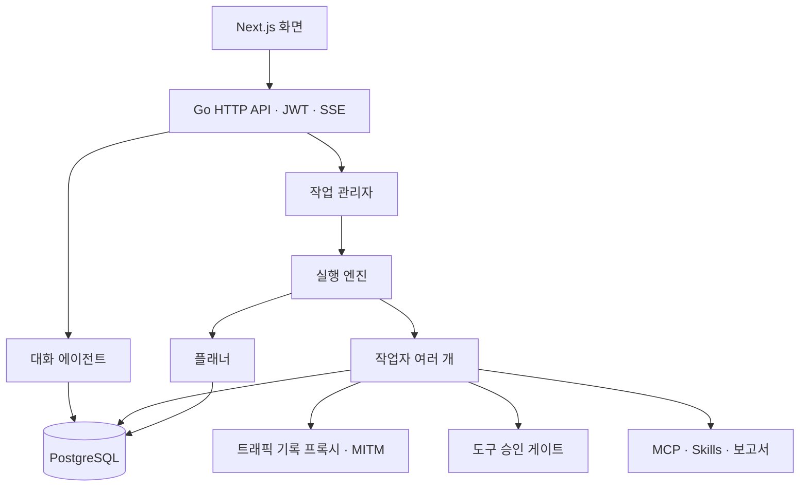
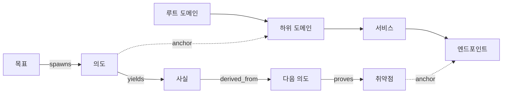

<div align="center">

# ARTEX

Go 백엔드와 Next.js 프런트엔드로 구성된 AI 자율 침투 테스트 도구

[온라인 데모](https://artex-demo.vercel.app/)

</div>

> [!IMPORTANT]
> 이 저장소는 [Autumn-27/ARTEX](https://github.com/Autumn-27/ARTEX) v0.3.14를 기준으로 2026-10-14에 제작한 비공식 한국어판입니다. 원 개발팀의 공식 배포본이 아니며, 공식 릴리스 이미지나 바이너리를 새로 내려받으면 한국어 패치가 포함되지 않습니다.

## 한국어판 다운로드

바로 실행할 수 있는 플랫폼별 바이너리와 설치 설명서, 전체 소스는 이 저장소의 **Releases**에서 `artex_kr.zip`으로 제공합니다. 압축을 푼 뒤 안에 있는 `README.md` 순서대로 실행하세요.

원본 저작권과 AGPL-3.0 라이선스 고지는 [LICENSE](LICENSE)에 그대로 보존되어 있습니다. 이 저장소의 번역과 수정 사항도 같은 라이선스로 배포됩니다.

## 화면 미리보기

| 대시보드 | 작업 목록 |
| :---: | :---: |
|  |  |

| 작업 실행 기록 | 탐색 그래프 |
| :---: | :---: |
|  |  |

| 취약점 | 자산 |
| :---: | :---: |
|  |  |

| 자산 범위 그래프 | 트래픽 기록 |
| :---: | :---: |
|  |  |

| 대화 | 에이전트 관리 |
| :---: | :---: |
|  |  |

| LLM 설정 | 차단 및 승인 |
| :---: | :---: |
|  |  |

## 주요 기능

- **승인 기록**: 작업과 대화에서 발생한 도구 승인 요청의 이유와 실행 정보를 펼쳐 볼 수 있습니다. 상세 화면은 [AegisHook의 승인 정보 구성요소](https://github.com/RuoJi6/AegisHook/blob/main/web/src/components/CallDetail.vue)를 참고했습니다.
- **자산 동기화**: [ScopeSentry](https://github.com/Autumn-27/ScopeSentry)의 주소와 API 키를 **자산 동기화** 화면에 입력하면 프로젝트 또는 작업 범위의 도메인, IP, 서비스, 엔드포인트 등을 가져올 수 있습니다. 가져온 자산은 ARTEX의 자산 그래프에 병합됩니다.
- **수동 재검증**: 작업 상세 화면의 **재검증** 탭 또는 취약점 목록에서 재검증 에이전트를 실행할 수 있습니다. 결과는 재현 가능, 수정됨, 확인 불가로 구분하며 원본 증거와 보고서를 보존합니다. 성공적으로 수정이 확인되면 취약점 상태를 자동으로 갱신합니다.
- **트래픽 증거**: 취약점에 여러 트래픽 기록을 연결하고 용도, 설명, 순서를 관리할 수 있습니다. 자세한 내용은 [취약점 트래픽 증거](docs/취약점-트래픽-증거.md)를 참조하세요.

## 설치와 실행

ARTEX에는 PostgreSQL이 필요합니다. 자율 탐색 기능을 사용하려면 `ANTHROPIC_API_KEY` 또는 `OPENAI_API_KEY`를 설정하거나 화면에서 LLM 구성을 등록해야 합니다. 처음 접속할 때 `/setup`에서 관리자 비밀번호를 설정합니다.

### 이 한국어 소스에서 빌드

Go 1.26.3 이상, Node.js와 npm, 실행 중인 PostgreSQL을 준비한 뒤 **현재 디렉터리에서** 다음 명령을 실행합니다.

```bash
cd web
npm ci
npm run build:static
cd ..
cp -R web/out/. server/webui/dist/
CGO_ENABLED=0 go build -tags embedui -o artex ./cmd/artex
cp config.example.json config.json
# config.json의 database 연결 정보와 skill_dir을 환경에 맞게 수정
./start.sh
```

`config.json`의 `skill_dir`을 비우거나 삭제하면 실행 파일 옆의 `skills/`를 기본값으로 사용합니다. 브라우저에서 `http://localhost:8787/setup`을 여세요. macOS와 Linux에서는 `./start.sh`, Windows에서는 `start.bat`를 사용합니다. 시작 스크립트는 업데이트 후 필요한 재시작도 처리합니다.

```json
{
  "database": {
    "host": "127.0.0.1",
    "port": 5432,
    "user": "artex",
    "password": "비밀번호",
    "dbname": "artex",
    "sslmode": "disable"
  },
  "skill_dir": ""
}
```

데이터베이스 연결은 환경 변수 `ARTEX_PG_DSN`으로도 지정할 수 있습니다. LLM 키는 `ANTHROPIC_API_KEY` 또는 `OPENAI_API_KEY`로 전달하거나 UI에서 등록합니다. 선택적 설정으로 `ARTEX_LLM_PROVIDER`, `ARTEX_LLM_MODEL`, `ARTEX_LLM_BASE_URL`, `ARTEX_LLM_PROXY`가 있습니다. 작업당 기본 작업자 수는 시스템 설정에서 조정합니다.

`./start.sh -addr :8787 -proxy :8788`처럼 주소를 지정할 수 있습니다. `-addr`은 웹 화면과 API, `-proxy`는 트래픽 기록 프록시의 주소입니다. 백그라운드로 실행하려면 `nohup ./start.sh >artex.log 2>&1 &`를 사용하세요.

### 릴리스 파일 만들기

`build.sh`는 프런트엔드를 내장한 바이너리를 만든 뒤 플랫폼별 ZIP 파일을 생성합니다. 기본 릴리스 대상은 Linux amd64/arm64, macOS amd64/arm64, Windows amd64입니다.

```bash
./build.sh --release
ARTEX_TARGETS=linux/amd64,windows/amd64 ./build.sh --release
./build.sh --target linux/amd64 --upx
```

UPX 압축은 일부 Linux 환경이나 보안 정책과 호환되지 않을 수 있어 기본적으로 사용하지 않습니다. 다른 기기로 옮길 때는 **대상 운영체제와 CPU 아키텍처에 맞는 바이너리**를 선택하고 PostgreSQL 연결을 설정해야 합니다.

### Docker 사용 시 주의

기존 `docker-compose.yml`의 `artex` 서비스는 공식 `autumn27/artex` 이미지를 내려받습니다. 그 이미지에는 이 작업 디렉터리의 한국어 패치가 들어 있지 않습니다. 한국어 버전을 사용하려면 위 소스에서 만든 바이너리를 실행하거나, 이 소스로 별도 이미지를 빌드하세요. Compose의 PostgreSQL 데이터와 `./data`, `./skills`는 볼륨으로 보존됩니다.

## 업데이트와 백업

ARTEX는 시작할 때 스키마 변경을 반복 실행해도 안전한 방식으로 적용합니다. 업데이트 전에 PostgreSQL 데이터베이스와 `data/`를 함께 백업하세요. 화면의 **시스템 설정 → 버전 및 업데이트** 또는 `./update.sh`로 공식 버전을 설치하면 한국어 패치가 덮어써질 수 있습니다. 한국어 버전을 유지하려면 패치된 소스를 다시 빌드해야 합니다.

화면에서 업데이트할 때는 릴리스 파일과 SHA-256을 확인하고 `artex.new`로 시험한 뒤 시작 스크립트가 교체와 재시작을 처리합니다. 시작에 연속해서 실패하면 `artex.old`로 롤백할 수 있습니다. 데이터베이스 스키마는 바이너리 롤백과 함께 되돌아가지 않습니다. 업데이트 중에는 실행 중인 작업이 중단되므로 적절한 시점에 진행하세요.

## 개발과 테스트

```bash
./dev.sh                    # 백엔드 :8787, 프록시 :8788, 프런트엔드 :5173
# 또는 각각 실행
go run ./cmd/artex
cd web && npm run dev
# 백엔드 테스트
go test ./...
# 백엔드 없이 화면만 확인
cd web && NEXT_PUBLIC_MOCK=1 npm run dev
```

개발 서버는 `/api` 요청을 Go 백엔드로 프록시합니다. `-tags embedui` 없이 Go를 실행하면 정적 프런트엔드가 바이너리에 포함되지 않습니다.

## 구조

ARTEX는 Go HTTP 서버, PostgreSQL, 정적 Next.js 프런트엔드, [`norma`](https://github.com/Autumn-27/norma) 기반 에이전트로 구성됩니다. 엔진은 작업마다 플래너와 여러 작업자를 실행합니다. 플래너는 새 탐색 방향을 의도로 기록하고, 작업자는 도구로 실행한 결과를 자산과 탐색 그래프에 반영합니다.



### 자산 그래프와 탐색 그래프

**자산 그래프**는 작업 간에 공유하는 자산의 원본 기록입니다. `root_domain`, `subdomain`, `ip`, `service`, `app`, `endpoint`와 기업 정보로 구성됩니다. 자산의 상하 관계와 중복 제거 키는 프로그램이 계산하고 에이전트는 발견한 원본 정보를 제출합니다.

**탐색 그래프**는 작업마다 별도로 유지하는 조사 흐름입니다. `goal`, `intent`, `fact`, `finding`, `hint` 노드가 `spawns`, `derived_from`, `yields`, `proves` 관계로 연결됩니다. `exploration_anchors(node_id, asset_id)`가 탐색 노드를 자산에 연결해 어느 자산에서 어떤 사실과 취약점을 확인했는지 추적할 수 있습니다.



엔진은 그래프 변경을 계기로 플래너를 다시 실행합니다. 플래너는 새로운 방향이 있을 때만 의도를 만들고, 작업자는 이를 가져가 실제 도구로 실행한 뒤 결과를 기록합니다. 작업자는 `search_all_worker_traces`, `list_worker_traces`, `get_worker_trace`로 다른 작업자의 실행 기록을 찾아볼 수 있습니다. 플래너의 작업별 공유 할 일 목록은 여러 실행에 걸친 의존 작업을 순서대로 진행하는 데 사용됩니다.

## 커뮤니티와 참고 자료

WeChat 공식 계정 **SecSentry**에서 그룹 참여 방법을 확인할 수 있습니다.

<div align="center">

</div>

참고 프로젝트: [Cairn](https://github.com/oritera/Cairn)

## 라이선스와 사용 조건

이 프로젝트는 [GNU Affero General Public License v3.0](LICENSE)에 따라 배포됩니다. 수정한 버전을 네트워크 서비스로 제공할 때는 AGPL-3.0이 요구하는 방식으로 해당 소스 코드를 제공해야 합니다.

원 프로젝트의 사용 조건은 개인 학습, 코드 연구, 로컬 격리 환경에서의 기술 검증으로 사용 범위를 제한합니다. 실제 웹사이트, 온라인 서비스, 네트워크 시스템을 대상으로 한 검사·탐지·악용·공격, 실제 침투 테스트, 운영 환경 사용을 금지합니다. 사용자에게 권한이 있거나 대상 시스템을 소유한 경우에도 이 제한을 적용한다고 명시합니다. 불법 침입, 데이터 탈취, 강탈, 서비스 거부, 파괴 행위 및 현지 법률 위반에도 사용할 수 없습니다.

사용자는 적용되는 보안·데이터 보호 관련 법규를 준수할 책임이 있습니다. 소프트웨어는 별도 보증 없이 제공되며, 사용으로 생긴 손실과 법적 분쟁에 관한 자세한 조건은 원 프로젝트의 [LICENSE](LICENSE)와 배포 안내를 확인하세요.
