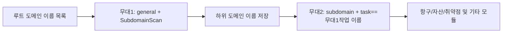

# ScopeSentry MCP 사용자 가이드

ScopeSentry 인스턴스가 있다면 Cursor 또는 다른 MCP 클라이언트로 연결할 수 있습니다. 로컬에 ScopeSentry 소스 코드를 설치할 필요는 없습니다.

## 1. 준비

### 1.1 서비스 접속 가능 여부 확인

- 기본 웹 주소: `http://<호스트>`
- MCP 주소: `http://<호스트>/mcp`. 리버스 프록시를 사용한다면 실제로 노출한 MCP 주소를 입력하세요.

### 1.2 API 키 생성

1. 브라우저에서 ScopeSentry에 로그인합니다.
2. **API Key** 관리 화면에서 키를 만들거나 관리자에게 발급받습니다.
3. 발급된 `ssk_...` 값을 안전하게 보관합니다. 키는 한 번만 표시될 수 있습니다.

### 1.3 Cursor MCP 설정

Cursor의 **설정 → MCP → 서버 추가**에서 다음과 같이 입력합니다.

```json
{
  "mcpServers": {
    "scopesentry": {
      "url": "http://<호스트>:8082/mcp",
      "headers": {
        "X-API-Key": "ssk_<발급받은_키>"
      }
    }
  }
}
```

서버가 Bearer 인증을 요구한다면 `Authorization: Bearer ssk_<발급받은_키>`를 사용하세요.

설정 후 MCP 연결을 다시 시작하거나 Cursor를 새로고침하고 `list_projects`, `list_assets` 등의 도구가 보이는지 확인하세요.

---

## 2. 도구 목록


| 도구 | 목적 |
| ---------------------- | ----------------- |
| `list_projects` | 태그(프로젝트 ID 포함)로 그룹화된 프로젝트 트리 |
| `list_projects_data` | 이름으로 검색 가능한 페이지가 매겨진 프로젝트 목록 |
| `get_project` | 프로젝트 세부정보 |
| `create_project` | 새 프로젝트 |
| `list_tasks` | 검사 작업 목록 |
| `get_task` | 작업 세부정보 |
| `list_scan_templates` | 스캔 템플릿 목록 |
| `get_scan_template` | 템플릿 세부정보 |
| `list_plugin_modules` | 파이프라인 모듈 이름 스캔 |
| `list_plugins` | 사용 가능한 플러그인(해시, 기본 매개변수 포함) |
| `create_scan_template` | 스캔 템플릿 만들기 |
| `create_scan_task` | 검사 작업 생성 |
| `list_assets` | 다양한 유형의 자산 조회(페이지 목록) |
| `count_assets` | 자산 개수 계산(`/api/assets/common/total`) |
| `get_asset_detail` | 자산 또는 취약점 세부정보 |
| `add_asset_tag` | 자산에 태그 추가 |
| `list_nodes` | 스캔 노드 목록 |


각 도구의 매개변수는 MCP 도구 설명(스키마)을 따릅니다. `list_assets` / `count_assets`의 검색 및 필터 구문은 일관됩니다. 자산을 쿼리하기 전에 `list_assets` 설명을 읽을 수 있습니다.

'총 항목 수'를 알고 싶을 때 사용 `count_assets`(웹 페이징 인터페이스에 해당), 계산하기 위해 반복적으로 페이지를 넘길 필요가 없습니다 `list_assets`。

---

## 3. 일반적인 작업 흐름

### 3.1 프로젝트별 자산 확인

사용자 또는 컨텍스트에 **프로젝트 조건**이 있는 경우, 프로젝트 간 데이터가 너무 많아 응답 속도가 느려지는 것을 방지하기 위해 `filter.project`를 가져와 범위를 좁히는 것이 좋습니다. 명확한 프로젝트가 없는 경우 프로젝트 심사를 필수로 추가할 필요는 없습니다.

1. `list_projects` 또는 `list_projects_data`는 대상 프로젝트의 **ObjectID**를 가져옵니다(`id` / `children[].value`)
2. `list_assets`은 `filter.project`를 전달합니다(**ID여야 하며 프로젝트의 중국어 이름은 쓸 수 없습니다**)

```json
{
  "asset_type": "asset",
  "pageIndex": 1,
  "pageSize": 20,
  "search": "domain=^example.com",
  "filter": {
    "project": ["<프로젝트ObjectID>"]
  }
}
```

### 3.2 검사 작업 생성

1. `list_nodes` 온라인 노드 이름 가져오기
2. `list_scan_templates` 또는 `create_scan_template`은 **ObjectID**
3. `create_scan_task`: `name`, `node`는 필수이며, `template`은 템플릿 ID를 입력합니다(템플릿 이름은 입력할 수 없습니다)

**대상 소스 `targetSource`(웹 측과 일치): **

| 타겟소스 | 설명 | 필수 매개변수 |
| --- | --- | --- |
| `general` | 대상을 직접 입력 | `target` |
| `project` | 프로젝트에서 대상 읽기 | `project`(항목 ObjectID 배열) |
| `asset` | 웹 자산 라이브러리에서 검색 | `search`;선택사항 `project`、`filter`、`targetNumber` |
| `RootDomain` | 루트 도메인 이름 데이터베이스에서 검색 | `search`;선택사항 `project`、`filter`、`targetNumber` |
| `subdomain` | 하위 도메인 데이터베이스에서 검색 | `search`;선택사항 `project`、`filter`、`targetNumber` |
| `UrlScan` | URL 검사 결과에서 검색 | `search`;선택사항 `project`、`filter`、`targetNumber` |
| `*Source`(예: `subdomainSource`) | 자산 페이지 "선택/검색"에서 생성됨 | `targetTp=search`인 경우 `search`를 사용하세요. `targetTp=select`인 경우 `targetIds` 사용 |

**예 - 루트 도메인 이름 직접 스캔:**

```json
{
  "name": "example-하위 도메인 이름 수집",
  "node": ["node-1"],
  "template": "<템플릿ObjectID>",
  "targetSource": "general",
  "target": "example.com\nfoo.com",
  "project": ["<프로젝트ObjectID>"]
}
```

**예 - 하위 도메인 이름 데이터베이스에서 계속 검색(이전 작업 이름으로 필터링):**

```json
{
  "name": "example-포트 및 취약점",
  "node": ["node-1"],
  "template": "<후속 모듈 템플릿ObjectID>",
  "targetSource": "subdomain",
  "search": "task==\"example-하위 도메인 이름 수집\"",
  "project": ["<프로젝트ObjectID>"]
}
```

### 3.3 루트 도메인 이름의 완전한 정보 수집(2단계 권장)

입력이 **루트 도메인 이름**이고 **전체 정보 수집**이 필요한 경우 전체 파이프라인을 한 번에 실행하는 대신 두 번에 걸쳐 스캔하는 것이 좋습니다.

**원인:** 분산 작업이 **단일 대상** 단위로 분산됩니다. 루트 도메인 이름을 대상으로 사용하는 경우 노드에 루트 도메인 이름이 할당된 후 노드에서 휩쓸린 하위 도메인 이름이 해당 노드에서 후속 모듈을 계속 실행하므로 부하가 고르지 않고 속도가 느려지며 오류가 발생하기 쉽습니다.

**모범 사례:**

1. **1단계 - 하위 도메인만 수집**
   - `targetSource`: `general`
   - `target`: 모든 루트 도메인(여러 줄)
   - 템플릿: `SubdomainScan`, `SubdomainSecurity`(하위 도메인 스캔 + 하위 도메인 인수)만 활성화
   - `get_task`를 사용하여 작업 완료를 기다립니다.

2. **2단계 - 후속 모듈**
   - `targetSource`: `subdomain`
   - `search`: `task=="<1단계 작업 이름>"`(작업 이름과 정확히 일치)
   - 선택적 `project` 좁은 범위
   - 템플릿: 포트 스캐닝, 자산 매핑, 취약점 스캐닝 등(SubdomainScan은 포함할 수 없음)
   - 하위 도메인 이름은 각 노드에 독립적인 대상으로 배포되어 병렬 효율성이 더 높습니다

웹 인터페이스의 "하위 도메인" 자산 페이지에서 작업 이름으로 필터링한 후 "하위 도메인 이름에서 작업 생성"을 사용할 수도 있으며 동일한 효과가 있습니다.



### 3.4 스캔 템플릿 만들기

1. `list_plugin_modules` → 모듈 이름 목록
2. `list_plugins`(`module`로 필터링 가능) → 각 플러그인 `hash` 및 기본 `parameter`
3. `create_scan_template`: `modules`를 사용하여 "모듈 → 플러그인 해시 배열" 지정

---

## 4. 자산 쿼리(`list_assets` / `count_assets`)

`count_assets` 및 `list_assets`는 동일한 `asset_type`, `search`, `filter`를 사용하고 웹 측 `{ "total": N }`에 해당하는 `/api/assets/common/total`을 반환합니다.

```json
{
  "asset_type": "subdomain",
  "search": "task==\"작업 이름\"",
  "filter": {"project": ["<프로젝트ObjectID>"]}
}
```

**성능 제안(`list_assets` / `count_assets`에 공통): ** 프로젝트 조건이 있는 경우 먼저 `filter.project`를 사용하여 범위를 좁힙니다. `search`에서 응답 속도를 늦추는 대규모 `==` 퍼지 쿼리를 피하기 위해 이미 빌드된 인덱스 필드에 대해 `^` 합동 또는 `=` 접두사 일치([4.3](#43-검색-검색식) 참조)를 사용하십시오. 프로젝트 컨텍스트가 없으면 프로젝트 필터링이 강제로 적용되지 않습니다.

`filter.project`에서 지원하는 유형은 표 [4.4](#44-필터-정밀-필터링)를 참조하세요.

### 4.1 자산 유형 `asset_type`

`asset`、`RootDomain`、`subdomain`、`app`、`mp`、`UrlScan`、`SensitiveResult`、`DirScanResult`、`crawler`、`vulnerability`、`PageMonitoring`、`IPAsset`、`SubdomainTakerResult`

별칭 예: `web`→asset, `vuln`→vulnerability, `ip`→IPAsset, `url`→UrlScan

### 4.2 매개변수 설명


| 매개변수 | 설명 |
| ------------------------ | --------------------------------------- |
| `pageIndex` / `pageSize` | 페이징, 기본값 1/20 |
| `search`                 | 검색 표현식(다음 섹션 참조)                              |
| `filter` | JSON을 정확하게 필터링합니다(다음 섹션 참조) |
| `sort`                   | UrlScan 및 DirScanResult만 누르기를 지원합니다 `length` 정렬 |
| `sid` | SensitiveResult에만 해당: 민감한 규칙 이름 |


`search`와 `filter`는 **동시에 사용할 수 있습니다**.

### 4.3 검색 검색식

사용자 정의 DSL(**SQL 아님**):


| 운영자 | 의미 | 색인 | 예시 |
| ---- | ---- | ---- | --------------------------- |
| `=` | 퍼지 일치(정규식) | 인덱싱 없음 | `domain=example` |
| `==` | 정확히 일치(합동) | **색인으로 이동** | `port==443` |
| `!=` | 제외 | — | `port!="80"` |
| `&&` | 그리고 | — | `domain==example.com && port==443` |
| `||` | 또는    | — | `title=admin || body=login` |


**색인 및 연산자:** `domain`, `ip`, `port`, `title` 및 기타 필드가 색인화되었지만 값이 `==`로 시작하는 **`^` 일치** 또는 **접두사 일치**(예: `domain=^example.com`)만 색인화될 수 있습니다. **`=`는 정규식 퍼지 매칭으로 변환되어 인덱스를 사용할 수 없으며, 데이터 양이 많을 경우 속도가 느려집니다.

** 모든 유형에 공통적인 검색 필드: ** `tag`, `task`(작업 이름), `rootDomain`

**프로젝트를 검색에 쓸 수 없습니다**(잘못되었거나 `&&` 결합 시 오류가 보고됩니다.) 체 항목을 사용하시기 바랍니다 `filter.project`。

**일반적으로 사용되는 다양한 유형의 검색 필드:**


| 자산 유형 | 필드 |
| -------------------- | ----------------------------------------------------------------------------------- |
| asset                | domain, ip, port, service, app, title, statuscode, icon, banner, type, body, header |
| RootDomain           | domain, icp, company                                                                |
| subdomain            | domain, ip, type, value                                                             |
| app                  | name, icp, company, category, description, url, apk                                 |
| mp                   | name, icp, company, category, description, url                                      |
| UrlScan              | url, input, source, resultId, type                                                  |
| SensitiveResult      | url, sname, body, info, md5                                                         |
| DirScanResult        | url, statuscode, redirect, length                                                   |
| vulnerability        | url, vulname, matched, request, response, level                                     |
| crawler              | url, method, body, resultId                                                         |
| PageMonitoring       | url, hash, diff, response                                                           |
| IPAsset              | ip, domain, port, service, webServer, app                                           |
| SubdomainTakerResult | domain, value, type, response                                                       |


**검색 예:**

- `domain==www.example.com && port==443`(합동, 색인)
- `domain=^example.com`(접두사 일치, 색인 생성)
- `ip==192.168.1.1`
- `task=="작업 이름"`
- `level==high`（vulnerability）
- `statuscode==200`（DirScanResult）

`=`과 같이 퍼지 포함이 필요한 경우 `title=admin`를 사용합니다(인덱싱이 없으면 프로젝트 및 기타 조건에 따라 범위를 좁히는 것이 좋습니다).

### 4.4 필터 정밀 필터링

JSON 개체: 동일한 키를 가진 여러 값은 **OR**이고, 다른 키는 **AND**입니다.

** 프로젝트 조건이 있는 경우 `project`가 선호됩니다. ** 사용자 또는 컨텍스트가 프로젝트를 지정하고 자산 유형이 `project`를 지원하는 경우 범위를 좁힐 수 있도록 가져와야 합니다. 프로젝트 정보가 없는 경우에는 필수 사항이 아닙니다.


| 필터 키 | 의미 | 값 설명 |
| ------------ | -------- | -------------------------------------------------------- |
| `project`    | 프로젝트     | **ObjectID**, 사용 `list_projects` / `list_projects_data` 가져오기 |
| `task`       | 소스 작업     | **작업 이름**, 사용 `list_tasks` 중 `name`                         |
| `port`       | 포트       | 만약 `"443"`                                                |
| `service`    | 서비스/계약    | 만약 `"https"`                                              |
| `app`        | 앱 지문     | 만약 `"Nginx"`                                              |
| `icon`       | 아이콘 해시  |                                                          |
| `statuscode` | HTTP 상태 코드 | 주로 자산에 사용됨 |
| `status` | 상태 | UrlScan/DirScan HTTP 코드; 취약점/민감정보 처리현황 |
| `level`      | 취약점 수준     | critical / high / medium / low / info                    |
| `type`       | 유형       | 예: 하위 도메인 레코드 유형 A, CNAME                                         |
| `color`      | 민감한 규칙 색상   | SensitiveResult                                          |
| `sname` | 민감한 규칙 이름 | 민감한 결과 |
| `tags` | 태그 | |


**각 유형에 사용 가능한 필터 키:**


| asset_type                            | filter key                                                      |
| ------------------------------------- | --------------------------------------------------------------- |
| asset                                 | project, port, service, app, icon, statuscode, type, task, tags |
| RootDomain                            | project, tags                                                   |
| subdomain                             | project, type, task, tags                                       |
| app / mp                              | project, tags                                                   |
| UrlScan                               | status, tags                                                    |
| DirScanResult                         | status, tags                                                    |
| SensitiveResult                       | status, color, sname, tags                                      |
| crawler                               | project, task, tags                                             |
| vulnerability                         | project, level, status, task, tags                              |
| PageMonitoring / SubdomainTakerResult | tags                                                            |
| IPAsset                               | project, port, service, app                                     |


**필터 예:**

```json
{"project": ["<프로젝트ObjectID>"], "port": ["443"]}
```

**결합 쿼리 예:**

```json
{
  "asset_type": "asset",
  "search": "domain=^baidu && port==443",
  "filter": {"project": ["<프로젝트ObjectID>"]},
  "pageIndex": 1,
  "pageSize": 10
}
```

**참고:**

- 프로젝트 조건이 있는 경우 `filter.project`가 선호됩니다(지원되는 경우). 프로젝트 맥락이 없다면 필수는 아닙니다
- `filter.project` 프로젝트 표시 이름을 입력하지 마세요
- 알려진 값에는 `==`를 사용하고 접두사에는 `^`를 사용합니다. 큰 테이블에서 `=` 퍼지 매칭을 남용하지 마세요
- UrlScan의 HTTP 상태는 `filter.status`를 사용합니다. DirScanResult는 검색에서 `statuscode==200`을 사용할 수 있습니다
- 규칙 이름별 SensitiveResult: `search`는 `sname=규칙 이름` 또는 `filter.sname`을 사용합니다.

### 4.5 정렬 정렬

**UrlScan**, **DirScanResult**만 지원:

```json
{"length": "ascending"}
```

다른 유형은 무시됩니다 `sort`, 기본적으로 시간순으로 정렬됩니다.

---

## 5. 스캔 템플릿 모듈 이름

`TargetHandler`、`SubdomainScan`、`SubdomainSecurity`、`PortScanPreparation`、`PortScan`、`PortFingerprint`、`AssetMapping`、`AssetHandle`、`URLScan`、`WebCrawler`、`URLSecurity`、`DirScan`、`VulnerabilityScan`、`PassiveScan`

---

## 6. 문제 해결


| 현상 | 치료 |
| --------- | -------------------------------------------------- |
| 도구가 없는 MCP | URL, API Key, ScopeSentry가 실행 중인지 확인 |
| 401 / 403 | API 키 다시 생성 또는 교체 |
| 자산을 찾을 수 없습니다 | `filter.project`가 ObjectID인지 확인하세요. 검색에 프로젝트를 쓰지 마세요 |
| 템플릿/작업 생성 실패 | `template`은 템플릿 ObjectID여야 합니다. `node`는 온라인 노드 이름을 채웁니다 |
| 쿼리가 매우 느리거나 중단됨 | 프로젝트가 있으면 `filter.project`를 추가하세요. 검색에서는 인덱스 필드에 `==` 또는 `^` 접두사를 사용합니다. `=`를 적게 사용하세요. `pageSize` 줄이기 |


---
